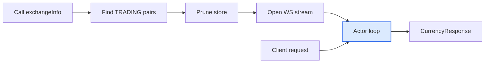

# Currency Service Architecture

## Purpose

The currency service maintains live exchange rates for a small set of fiat currencies against USDT (Tether, a USD-pegged stablecoin). It exposes conversion rates to the rest of the application through an actor-style request/response channel, and persists updated rates back to PostgreSQL on shutdown.

## Module location

```text
internal/services/currency/
  currency.service.go      # Core service, actor loop, Init, Shutdown
  binance.currency.go      # Binance integration (encode, validity check, websocket)
  messenger.currency.go    # Request/response messenger
  currency_service_test.go # Tests
```

## Components

### CurrencyService

Holds runtime state:

| Field    | Type                             | Purpose                                                      |
| -------- | -------------------------------- | ------------------------------------------------------------ |
| `repo`   | `repository.RepositoryInterface` | Database access (get active currencies, update rates)        |
| `store`  | `map[string]models.Currency`     | In-memory currency cache keyed by currency code (e.g. `EUR`) |
| `logger` | `*slog.Logger`                   | Structured logger                                            |
| `env`    | `*configs.Env`                   | Runtime configuration                                        |

### CurrencyServiceMessenger

The public entry point for conversion requests. Holds a single channel (`messageChan`) through which `CurrencyRequest` messages are sent to the actor loop.

```go
type CurrencyRequest struct {
    from     string
    to       string
    respChan chan CurrencyResponse
}

type CurrencyResponse struct {
    Rate       float64
    DollarRate float64
    Err        error
}
```

`MakeCurrencyRequest(ctx, from, to)` sends a request and waits for a response, with a 5-second timeout on both the send and the receive.

### CurrencyUpdateMessage

Internal message produced by the Binance WebSocket reader and consumed by the actor loop:

```go
type CurrencyUpdateMessage struct {
    code  string // e.g. "EUR"
    price float64
}
```

## Constants

| Constant        | Value                    | Meaning                                                 |
| --------------- | ------------------------ | ------------------------------------------------------- |
| `BASE`          | `"USDT"`                 | Quote currency suffix appended to every symbol          |
| `ALLOWED_PAIRS` | `["EURUSDT", "GBPUSDT"]` | The only currency pairs the service is allowed to track |

## Startup flow (`Init`)

`InitCurrencyService` constructs the service, creates a buffered request channel (capacity 100), and calls `service.Init(ctx, currencyRequestChan)`.

`Init` performs the following steps:

1. **Default logger/store** — assigns `slog.Default()` and an empty store if nil.
2. **Load active currencies** — calls `repo.GetActiveCurrencies(ctx)` to load active currencies from PostgreSQL.
3. **Validate against Binance** — calls `checkValidityAndBuildAllowedCurrencies(ctx, &currencies)`:
   - Filters the in-memory list to `ALLOWED_PAIRS` only.
   - Calls Binance REST `exchangeInfo` with the candidate symbols as a JSON-encoded query parameter.
   - Builds an `allowed` map of symbols whose Binance status equals `BINANCE_ALLOWED_TERM` (`TRADING`).
   - Returns the `allowed` map; currencies not in `ALLOWED_PAIRS` are not added to the store.
4. **Prune store** — iterates `c.store`; keeps only currencies whose `CODE + BASE` symbol is in the Binance `allowed` map, deleting the rest.
5. **Empty list guard** — if no symbols remain, returns `errs.ERR_EMPTY_CURRENCY_LIST`.
6. **Connect WebSocket** — creates the buffered (capacity 1) `currencyUpdateChan`, then calls `HandleWebsocketConn(ctx, symbols, currencyUpdateChan)` to open a Binance trade stream for the allowed symbols (lowercased, e.g. `eurusdt@trade`). If the initial connection fails after its retries, `Init` returns that error and the service doesn't start.
7. **Start actor loop** — launches a goroutine that:
   - Listens on `ctx.Done()` → calls `Shutdown(ctx)` and returns.
   - Listens on `currencyUpdateChan` → updates `c.store[code].LastKnownRateToDollars`.
   - Listens on `CurrencyRequestChan` → computes conversion responses.

## Binance integration

### `encode(baseURL, query, values)`

Serializes `values` (a `[]string` of symbols) to JSON and sets it as a query parameter on `baseURL`. Used to query `exchangeInfo` for a specific list of symbols.

### `connect(ctx, dialer, url)`

Shared dial helper: up to 3 attempts, with a 1s / 2s / 3s backoff between them. Used both for the initial WebSocket connection and for every reconnect, so both paths share the same retry behavior.

### `checkValidityAndBuildAllowedCurrencies`

Validates that the currencies the application knows about are actually tradable on Binance:

- Builds `initiallyAllowed` from `ALLOWED_PAIRS`.
- For each active DB currency, if `CODE + BASE` is in `initiallyAllowed`, adds it to `c.store` and appends the symbol to the query list.
- Calls Binance `exchangeInfo` with a 5-second timeout; returns `errs.ERR_BINANCE_BAD_RESPONSE` on non-200 status.
- Filters Binance response symbols by `status == env.BINANCE_ALLOWED_TERM` into the returned `allowed` map.

### `HandleWebsocketConn`

- Builds the Binance combined stream URL (`streams=eurusdt@trade/gbpusdt@trade`).
- Opens the initial connection via `connect`; if every attempt fails, returns the error — `Init` then fails too, so the service won't start without a working feed.
- Runs two goroutines:
  - **Reader** — reads raw WebSocket frames in a loop:
    - `net.ErrClosed` (closed by us) → exits, no reconnect.
    - A server close or a network error → reconnects via `connect` and swaps the connection pointer atomically.
    - Any other error → retries on the same connection; past 3 in a row, sends to `errChan` and exits for good, no reconnect attempted.
    - A clean read is forwarded as raw bytes to an internal channel.
  - **Processor** — selects on `ctx.Done()` (closes the connection, returns), `errChan` (logs and returns), and the reader's raw-byte channel: unmarshals each message, drops malformed JSON, symbols without the `USDT` suffix, and prices that are `<= 0`, `NaN`, or `Inf`, and forwards everything else as a `CurrencyUpdateMessage` to the buffered (capacity 1) `currencyUpdateChan`.

## Actor loop

Runs inside `Init` as a goroutine. It is the single writer to `c.store` and the single handler of conversion requests.

- **Price update** (`CurrencyUpdateMessage`): if the code exists in `c.store`, updates `LastKnownRateToDollars`; otherwise logs a warning and drops it.
- **Conversion request** (`CurrencyRequest`):
  - Looks up `from` and `to` in `c.store`.
  - Returns `errs.ERR_UNSUPPORTED_CURRENCY` if either is missing.
  - Computes:
    - `Rate = from.LastKnownRateToDollars / to.LastKnownRateToDollars`
    - `DollarRate = from.LastKnownRateToDollars`
  - Sends `CurrencyResponse` back on `req.respChan`.

## Shutdown (`Shutdown`)

- If `repo` is nil, returns nil immediately.
- Builds a fresh 5-second timeout from `context.WithoutCancel(ctx)` — `Shutdown` runs exactly when `ctx` is already done, so stripping its cancellation first is what lets the timeout actually apply instead of failing instantly.
- Collects all currencies from `c.store`.
- Calls `repo.UpdateCurrencies(ctx, currencies)` to persist `last_known_rate_to_dollars` for each currency by `id`, and propagates its error.
- Called from the actor loop's `ctx.Done()` case; if it errors, the error is logged and the loop exits anyway.

## Concurrency model

- The actor loop is the **sole writer** to `c.store`.
- `HandleWebsocketConn`'s reader and processor goroutines run separately from the actor loop, communicating with it exclusively through the buffered (capacity 1) `currencyUpdateChan`.
- `CurrencyServiceMessenger` communicates with the actor loop through `messageChan` (buffered, capacity 100).
- WebSocket connection pointer is managed with `atomic.Pointer[websocket.Conn]` so reconnection can swap it safely.
- Context cancellation propagates through `connect`, the WebSocket reader, the actor loop, and `MakeCurrencyRequest`.

## Data flow



The actor loop is the sole writer to the in-memory store; on shutdown it flushes every currency's last known rate to PostgreSQL via `repo.UpdateCurrencies`.

## Errors

| Error                               | Meaning                                         |
| ----------------------------------- | ----------------------------------------------- |
| `ERR_UNSUPPORTED_CURRENCY`          | Requested currency not in store                 |
| `ERR_EMPTY_CURRENCY_LIST`           | No currencies remained after Binance validation |
| `ERR_CURRENCY_SERVICE_UNRESPONSIVE` | Messenger send/receive timed out (5s)           |
| `ERR_BINANCE_BAD_RESPONSE`          | Binance returned non-200 status                 |
